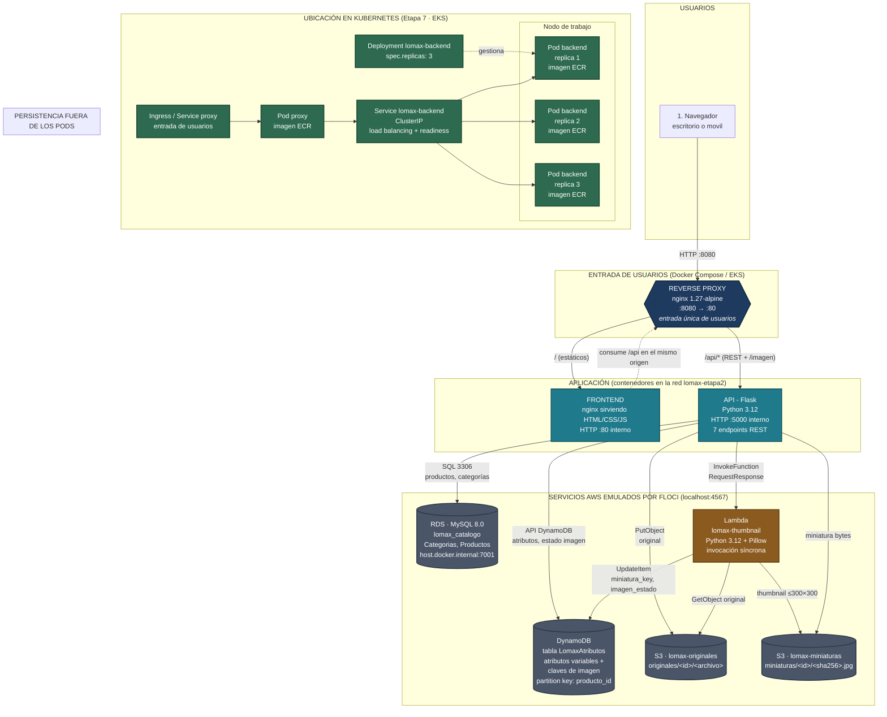

# Etapa 1 — Arquitectura de la solución

Diagrama de arquitectura de Lomax SA con la entrada de usuarios, los
componentes de aplicación, los servicios de AWS emulados por FLOCI y su
ubicación en Kubernetes.

## Diagrama

## Componentes, protocolos y puertos

| Componente | Imagen | Puerto interno | Puerto publicado | Protocolo |
|---|---|---|---|---|
| Reverse proxy (entrada) | `proxy/Dockerfile` (nginx 1.27-alpine) | 80 | **8080** → 80 | HTTP |
| Frontend | `frontend/Dockerfile` (nginx) | 80 | ninguno | HTTP |
| API (backend) | `backend/Dockerfile` (python:3.12-slim) | 5000 | ninguno | HTTP REST |
| FLOCI (emulador AWS) | `floci/floci:2.1.0-compat` | 4566 | 4567, 7001-7099, 6500-6599, 5100 | HTTP |
| RDS MySQL | gestionado por FLOCI | 3306 | 7001 | MySQL |
| DynamoDB | gestionado por FLOCI | — | vía 4567 | HTTP API |
| S3 | gestionado por FLOCI | — | vía 4567 | HTTP API |
| Lambda | `lambda/handler.py` | — | vía 4567 | invocación HTTPS |
| ECR (registro OCI) | gestionado por FLOCI | 5100 | 5100 | Docker Registry v2 |
| EKS (k3s) | gestionado por FLOCI | 6500-6599 | 6500-6599 | Kubernetes API |

## Protocolos

- **HTTP** entre navegador → proxy → frontend y API.
- **MySQL** entre la API y RDS.
- **HTTPS (API de AWS)** entre la API y DynamoDB/S3/Lambda, apuntando a
  `http://localhost:4567` con las credenciales de demostración.
- **Docker Registry v2** entre `docker push`/`docker pull` y ECR.

## Almacenamiento

| Almacén | Contenido | Clave |
|---|---|---|
| RDS `lomax_catalogo` | `Categorias`, `Productos` | `producto_id` (auto_increment) |
| DynamoDB `LomaxAtributos` | Atributos variables, `imagen_original_key`, `miniatura_key`, `imagen_estado` | `producto_id` (numérica) |
| S3 `lomax-originales` | Fotografías originales | `originales/<id>/<archivo>` |
| S3 `lomax-miniaturas` | Miniaturas ≤300×300 | `miniaturas/<id>/<sha256>.jpg` |

## Redes

| Red | Tipo | Quiénes participan |
|---|---|---|
| `lomax-etapa2` | bridge, definida por Compose | proxy, frontend, backend, floci |
| `lomax-etapa2_default` | la que ve Floci | floci, mysql-rds (y los Pods en EKS) |

## Ubicación de los componentes en Kubernetes (Etapa 7)

| Componente | Namespace | Tipo | Notas |
|---|---|---|---|
| Reverse proxy | `lomax` | Pod | Entrada de usuarios, desde ECR |
| Frontend | `lomax` | Pod | Estáticos, desde ECR |
| Backend | `lomax` | Deployment (3 réplicas) + Service ClusterIP | Desde ECR |
| RDS | externo | servicio gestionado | Host del clúster, no Pod |
| DynamoDB | externo | servicio gestionado | sdk vía endpoint |
| S3 | externo | servicio gestionado | sdk vía endpoint |
| Lambda | externo | servicio gestionado | invocada por la API |

**Punto clave**: RDS, DynamoDB, S3 y Lambda quedan **fuera** de los Pods. Por
eso al borrar un Pod el catálogo sigue disponible: los datos no viajan con el
contenedor.

## Verificación E1

**Recorrido de una consulta del catálogo:**

1. El navegador pide `http://localhost:8080/`.
2. El reverse proxy enruta `/` al frontend y devuelve el HTML.
3. `app.js` llama a `GET /api/productos` en el **mismo origen**.
4. El proxy quita `/api` y reenvía a `backend:5000`.
5. La API consulta en **RDS** los productos `PUBLICADO` y en **DynamoDB** los
   atributos y la clave de miniatura de cada uno.
6. Devuelve la lista combinada con `miniatura_url` por producto.
7. El navegador pide cada `GET /api/productos/<id>/imagen`.
8. La API lee `miniatura_key` de **DynamoDB** y descarga los bytes de **S3**.

**Recorrido de un registro con publicación:**

1. `POST /api/productos` → **RDS** inserta `PENDIENTE`; **DynamoDB** guarda los
   atributos. Si DynamoDB falla, se revierte la fila de RDS.
2. `POST /api/productos/<id>/imagen` → la API sube el original a **S3** y marca
   `imagen_estado = PROCESANDO` en DynamoDB.
3. La API invoca **Lambda** de forma síncrona.
4. Lambda lee el original de S3, genera la miniatura ≤300×300 y la guarda.
5. Lambda escribe `miniatura_key` e `imagen_estado = LISTA` en DynamoDB.
6. La API confirma y cambia el producto a `PUBLICADO` en RDS.
7. Si Lambda devuelve `ERROR`, el producto **permanece** `PENDIENTE` y puede
   reintentarse con `POST /productos/<id>/reprocesar`.

**Contraste con lo desplegado**: cada nodo del diagrama corresponde a un
contenedor de `docker compose ps`, a un recurso de `aws` (RDS, DynamoDB, S3,
Lambda, ECR) o a un objeto de `kubectl get all` en la Etapa 7. La tabla de
puertos coincide con las secciones `ports:` de `docker-compose.yml`.
